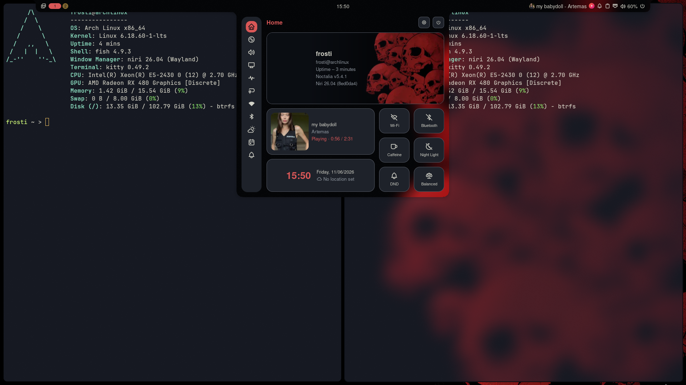

# Hello world!
#### This repository is designed to store **configuration files** and other useful resources to help you get started *easily* with an operating system *(primarily Arch Linux)*.

#### **Don't forget**! *Everything* can be changed within the **config** itself; I’m simply pointing out what is used in **my own** configs.

## Preview:

## Paths:
- **Niri and Noctalia** - `~/.config/niri/config.kdl | noctalia.kdl`
- **Kitty** - `~/.config/kitty/kitty.conf`
- **Fastfetch** - `~/.config/fastfetch/config.jsonc`
- **Fish** - `~/.config/fish/config.fish`

## Dependencies:
1. **Niri:**
    - ***Noctalia***
    - *PipeWire / PulseAudio*
    - *Kitty*
    - *Fuzzel*
    - *Swaylock*
    - *Firefox*

2. **Kitty:**
    - ***Fish***
    - ***Fastfetch***
    - *JetBrains-Mono font*
